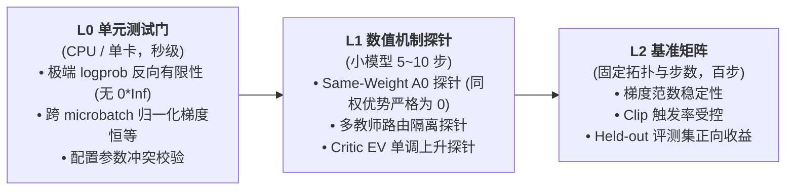

# GRPO双重归一化偏差、Critic参数桶解耦与截断GAE自举

> 日期：2026-11-16  
> 来源：`inbox/2026-11-16.md`  
> 状态：已整理  
> 关联主题：RL 强化学习、归一化偏置、分布式并行参数绑定、GAE 截断估计、多算法门禁体系

## 整理记录

- 2026-11-16 18:25：当天主整理（从全天 Antigravity 交互日志中提炼脱敏后的通用算法与系统理论）。
- 归一化偏差一节接着 [10 月 12 日 批级 Advantage 归一化的偏移机制](../10/GRPO流程与批级Advantage归一化的偏移机制_20261012.md) 与 [10 月 16 日 截断采样 × 批级归一化的崩溃机制](../10/截断采样与批级归一化的双条件崩溃机制_20261016.md) 读。
- GAE 截断自举一节接着 [10 月 20 日 PPO Critic 价值估计与 GAE 参数](../10/PPO的Critic价值估计GAE参数与工程适配_20261020.md) 读。
- Critic 参数桶解耦一节接着 [10 月 21 日 PPO Critic 价值头初始化与 PP 下的共享词嵌入](../10/PPO_Critic的价值头初始化两种预热与EV上限_20261021.md) 读。
- 多算法统一门禁一节接着 [11 月 09 日 多教师在线蒸馏的实现要点](多教师在线蒸馏的实现要点_20261109.md) 读。

## 0. 今天最终要解决的问题

1. **GRPO 为什么不能同时开组内奖励归一化（`reward_norm`）与批级优势归一化（`adv_norm`）？**
   在标准 PPO 中默认开启的批级优势归一化，搬到 GRPO 中后，为什么会导致长短回答之间的系统性基线漂移，甚至污染方差为 0 的样本组？
2. **截断回答在保留真实终态奖励时，GAE 为什么不能重复加上 Critic 的状态自举价值？**
   时间步耗尽（Truncation）与自然终止（Termination）在环境判分中是如何重叠的？如果判分器已对截断不完整回答给出了整条轨迹的评估得分，再在 GAE 中加上 $V(s_T)$ 会引发什么数值错误？
3. **Megatron-LM 与 PyTorch DDP 下，为什么“在 DDP 包装后才替换 ValueHead”会导致 Critic 静默不训练？**
   分布式训练框架中的底层连续参数桶（Parameter Buckets）与 PyTorch 模块层（`nn.Module`）的张量引用是如何工作的？为什么 Python 前向反向正常计算梯度，优化器却执行了空更新？
4. **GRPO、GSPO、PPO、OPD、MOPD 五种算法的目标函数统一契约与最低成本验证门禁是什么？**
   如何用 L0 单元测试门、L1 数值机制探针（A0 探针、隔离探针）在不烧大规模算力的情况下提前拦截数值发散与路由错误？

## 1. 先给结论

- **GRPO 开启组内奖励归一化后，必须关闭批级优势归一化**：
  GRPO 的数学基线是确保每个 Prompt 组在 Response 粒度的优势期望为 0（$\mathbb{E}_{\text{group}}[A] = 0$）。若把标量优势广播到各个 token 后再次执行批级 token 均值归一化，由于长样本 token 数量多、在批均值 $\mu_{\text{batch}}$ 中权重更大，会导致基线向长样本倾斜；且全对/全错的零方差组（$\sigma_{\text{group}}=0$）在被减去非零批均值后会被赋予虚假优势，破坏相对学习信号。
- **终态判分与状态价值自举不可叠加**：
  在 LLM RLVR 场景中，若判分器在回答被截断时直接评估该截断输出并给出最终标量奖励 $R_T$，则该奖励已经代表了整条轨迹的结局。此时 GAE 的终止掩码应置为完成，屏蔽额外的 Critic 价值自举 $\gamma V(s_T)$；否则同一时间步的价值被双重计数（Double-counting），诱导策略偏向生成冗长截断的回答。
- **DDP 包装冻结了通信桶与优化器参数分片**：
  PyTorch DDP 在初始化时遍历参数并构建连续通信桶；Megatron `DistributedOptimizer` 依此建立优化器状态指针。在 DDP 包装之后通过属性赋值替换 `output_layer` 为 `ValueHead`，新层张量未挂载 DDP Reducer 通信钩子，其梯度不参与跨卡 AllReduce；优化器依然更新旧层的内存视图，导致新 ValueHead 权重永久冻结（静默假训练）。必须在 DDP 包装之前完成模型全部结构的构建与替换。
- **五算法演进依赖分级验证门禁**：
  验证算法正确性不应直接依赖大规模长跑，而应遵循 L0（极端数值反向有限性防 `0 * Inf`、切分梯度守恒）→ L1（同权 A0 蒸馏优势 bitwise 归零、多教师路由隔离、价值头预热单调性）→ L2（固定场景稳定性指标与 Held-out 评测矩阵）的三级门禁。

## 2. 前置概念

### 2.1 组内归一化 vs 批级归一化

- **组内归一化（Group Normalization, `reward_norm`）**：
  对单个 Prompt $q$ 采样的 $G$ 条候选响应 $\{o_1, \dots, o_G\}$，其标量奖励为 $\{r_1, \dots, r_G\}$。
  计算组内均值与方差：
  $$\mu_g = \frac{1}{G}\sum_{i=1}^G r_i, \quad \sigma_g = \sqrt{\frac{1}{G}\sum_{i=1}^G (r_i - \mu_g)^2 + \epsilon}$$
  组内归一化标量优势为：
  $$\tilde{r}_i = \frac{r_i - \mu_g}{\sigma_g}$$
  性质：在 Response 粒度上，组内均值恒等于 0，$\sum_{i=1}^G \tilde{r}_i = 0$。

- **批级归一化（Batch Advantage Normalization, `adv_norm`）**：
  将每个响应的优势广播到其生成的所有 token 上，形成序列张量 $A_{i,t} = \tilde{r}_i$（$1 \le t \le |o_i|$）。在包含 $B$ 个 Prompt、总计 $N_{\text{tokens}} = \sum_{i=1}^{B \times G} |o_i|$ 个有效 token 的整个训练批次上，计算 token 维度的均值与标准差：
  $$\mu_B = \frac{1}{N_{\text{tokens}}}\sum_{i,t} A_{i,t}, \quad \sigma_B = \sqrt{\frac{1}{N_{\text{tokens}}}\sum_{i,t} (A_{i,t} - \mu_B)^2 + \epsilon}$$
  二次归一化优势为：
  $$\hat{A}_{i,t} = \frac{A_{i,t} - \mu_B}{\sigma_B}$$

### 2.2 DDP 参数展平与 DistributedOptimizer

- **DDP 连续参数桶（Contiguous Parameter Buckets）**：
  为了将小张量梯度的零碎通信融合成高带宽通信，DDP 初始化时把模型的 `parameters()` 按反向传播顺序聚合为若干个大内存块（Buckets）。当某个 Bucket 内的所有参数都计算出梯度后，触发一次异步 `AllReduce`。
- **DistributedOptimizer**：
  Megatron 的分布式优化器（ZeRO-1 风格），将 DDP 已经展平的主参数、梯度和优化器状态（一阶动量、二阶动量）均匀切分到数据并行组（DP Group）的各个 Rank 上。每个 Rank 仅维护自己切片内的参数更新。

### 2.3 RL 中的终止（Termination）与截断（Truncation）

- **Termination（环境终态）**：Agent 自然达成终止条件（例如生成 `<endoftext>`、数学题目给出最终答案）。后续没有未来状态，未来期望收益 $V(s_{T+1}) \equiv 0$。
- **Truncation（时间步截断）**：Agent 因达到计算步数上限或最大 token 上限被强制中断。Agent 本身仍有继续推进任务的能力，其在被截断时刻的未来期望收益应由价值函数补齐：$G_T = R_T + \gamma V(s_{T+1})$。

## 3. 完整原理

### 3.1 GRPO 双重归一化的数学冲突与长度偏置

假设一个 Batch 内有两个 Prompt $q_A$ 和 $q_B$，组大小 $G=2$：
- $q_A$ 产生的两条回答长度均为 $|o|=10$ tokens，标量奖励分别为 $r_{A,1} = 1.0$，$r_{A,2} = 0.0$。
  - 组内均值 $\mu_{g,A} = 0.5$，标准差 $\sigma_{g,A} = 0.5$。
  - 组内归一化优势：$\tilde{r}_{A,1} = +1.0$，$\tilde{r}_{A,2} = -1.0$。
- $q_B$ 产生的两条回答长度严重不均：$o_{B,1}$ 为长回答（$|o|=90$ tokens），$r_{B,1} = 1.0$；$o_{B,2}$ 为短回答（$|o|=10$ tokens），$r_{B,2} = 0.0$。
  - 组内均值 $\mu_{g,B} = 0.5$，标准差 $\sigma_{g,B} = 0.5$。
  - 组内归一化优势：$\tilde{r}_{B,1} = +1.0$，$\tilde{r}_{B,2} = -1.0$。

此时两个 Prompt 在 Response 粒度的相对评估完全一致（正确得 +1，错误得 -1）。

现在执行 token 维度的批级优势归一化：
1. **统计有效 Token 总数**：
   $$N_{\text{tokens}} = 10 + 10 + 90 + 10 = 120 \text{ tokens}$$
2. **计算全批 Token 均值 $\mu_B$**：
   $$\sum_{i,t} A_{i,t} = 10 \times (+1.0) + 10 \times (-1.0) + 90 \times (+1.0) + 10 \times (-1.0) = 10 - 10 + 90 - 10 = 80$$
   $$\mu_B = \frac{80}{120} = +0.667$$
3. **计算二次归一化后的样本优势**：
   - 样本 $A,1$（中等长正确回答，组内原本优势 +1.0）：
     $$\hat{A}_{A,1} \propto (+1.0 - 0.667) = +0.333$$
   - 样本 $A,2$（中等长错误回答，组内原本优势 -1.0）：
     $$\hat{A}_{A,2} \propto (-1.0 - 0.667) = -1.667$$
   - 检查组 $A$ 的平均优势：
     $$\text{Mean}_{\text{group } A}(\hat{A}) \propto \frac{+0.333 - 1.667}{2} = -0.667 \ne 0$$

**数学破坏点**：
- **基线破坏（Baseline Corruption）**：组 $A$ 的两条回答明明是一对一错，但因为组 $B$ 碰巧长样本答对了、拉高了批均值，导致组 $A$ 的均值整体被拉踩成负数。
- **零方差组惩罚（Zero-Variance Group Distortion）**：如果存在组 $C$，两条回答均答对，$\tilde{r}_{C,1} = \tilde{r}_{C,2} = 0$。在二次归一化后：
  $$\hat{A}_{C} \propto (0 - 0.667) = -0.667$$
  全部答对的完美回答，仅仅因为其他组有长样本正奖励，就被赋予了巨大的负优势，受到严厉的梯度惩罚！

### 3.2 截断 GAE 的自举双重叠加机理

在标准 GAE 公式中，时序差分误差（TD-Error）定义为：
$$\delta_t = R_t + \gamma V(s_{t+1}) (1 - d_t) - V(s_t)$$
其中 $d_t$ 为截断/终止指示变量。

在 LLM RLVR 场景中，整个生成阶段内部没有环境奖励（$R_t = 0, \forall t < T$），唯一的奖励集中在最后一个有效 token 位置 $T$。

```mermaid
flowchart TD
    subgraph 正确契约
        T1["生成达到 max_tokens 截断"] --> T2["Judge 判分器评估不完整文本"]
        T2 --> T3["给出终态惩罚 R_T (如 0 分)"]
        T3 --> T4["设定 Termination 掩码 d_T = 1"]
        T4 --> T5["delta_T = R_T - V(s_T)<br/>(未来自举归零)"]
    end

    subgraph 缺陷实现 (双重叠加)
        E1["生成达到 max_tokens 截断"] --> E2["Judge 给出终态惩罚 R_T"]
        E2 --> E3["is_truncated == True<br/>触发自举逻辑"]
        E3 --> E4["强制加上 gamma * V(s_T)"]
        E4 --> E5["delta_T = R_T + gamma * V(s_T) - V(s_T)<br/>(双重叠加，价值虚假膨胀)"]
    end
```

**缺陷后果**：
若截断处既收下了判分器给的 $R_T$，又强行加上 $\gamma V(s_T)$，会导致长尾截断序列在 Critic 早期估计偏大时获得异常正优势。模型学会利用截断自举漏洞，故意把推导写长拖到超限，引发训练崩溃。

### 3.3 Megatron Critic 参数桶脱节机理

以下为调用时序导致的内存视图脱节图解：

```mermaid
sequenceDiagram
    participant Code as 用户模型初始化代码
    participant Megatron as Megatron get_model()
    participant DDP as PyTorch DDP
    participant Opt as DistributedOptimizer

    Code->>Megatron: 调用 get_model(wrap_with_ddp=True)
    Megatron->>DDP: 实例化 Backbone 并构建模型
    Note over DDP: 遍历所有 named_parameters()<br/>分配连续参数桶 Buffer<br/>旧 output_layer 注册进桶中
    DDP-->>Code: 返回已包装 DDP 的模型实例
    Note over Code: 错误时序：在此处执行<br/>model.output_layer = ValueHead()
    Code->>Opt: 初始化 DistributedOptimizer(model)
    Note over Opt: 读取 DDP 桶中的参数切片<br/>旧 output_layer 属于优化器更新列表<br/>新 ValueHead 未在 DDP 桶中！
    
    rect rgb(240, 240, 240)
    Note over Code,Opt: 训练 Forward / Backward 阶段
    Code->>Code: 前向走新 ValueHead，计算 loss
    Code->>Code: 反向传播，新 ValueHead.weight.grad 产生
    DDP->>DDP: 触发 DDP AllReduce<br/>仅对桶内参数通信，新 ValueHead 无通信！
    Opt->>Opt: 执行 optimizer.step()<br/>优化器读取旧 output_layer 梯度 (全为 0)<br/>新 ValueHead 权重永远不更新！
    end
```

**底层规则**：
1. **参数不可变性约束**：在分布式通信与优化器完成初始内存绑定后，禁止直接做 Python 属性层替换；
2. **流水线并行 Stage 约束**：Critic 的 `ValueHead` 仅在最后流水线 Stage（`is_pipeline_last_stage()`）构建，其余 Stage 仅包含语言模型 Transformer 层，且必须执行词表解绑：
   ```python
   if mcore_model.share_embeddings_and_output_weights and hasattr(mcore_model, "untie_embeddings_and_output_weights"):
       mcore_model.untie_embeddings_and_output_weights()
   ```

### 3.4 五算法统一目标函数与三级验证门禁

| 算法 | 核心优势与目标公式 | 关键防护参数 | 易错点 |
| :--- | :--- | :--- | :--- |
| **GRPO** | $A_i = \frac{r_i - \mu_g}{\sigma_g}$，标量广播；PPO Token Clip | `reward_norm=True`, `adv_norm=False` | 不可叠加批级 `adv_norm` |
| **GSPO** | 序列级比率 $s_i = \prod_{t=1}^{|o_i|} \frac{\pi_\theta(o_{i,t})}{\pi_{\text{old}}(o_{i,t})}$，按轮裁剪 | `importance_sampling_level="sequence"` | 长序列累乘数值下溢/溢出 |
| **PPO** | 双网络；$A_t = \text{GAE}(\gamma, \lambda)$；$L_{\text{critic}} = (V_\phi - R_{\text{ret}})^2$ | `critic_warmup_steps`, `explained_variance` | 价值头初始化过大、预热不充分 |
| **OPD** | 学生结合任务奖励与单教师蒸馏（优势叠加式或 $k_2$ 散度正则） | `teacher_loss_weight`, `log_ratio_clip` | 教师 Logprob 未 detach 导致梯度反传 |
| **MOPD** | 多专家教师按任务域并发打分，在线混域配额 | `mixture_quota`, `route_key`, `log_ratio_clip=20` | 路由串线、跨域配额漂移、内存泄露 |

#### 三级验证门禁（Verification Gates）



## 4. 与已有知识的联系

- **与 10 月 12 日 [批级 Advantage 归一化的偏移机制](../10/GRPO流程与批级Advantage归一化的偏移机制_20261012.md) 的联系**：
  10 月 12 日笔记指出批级归一化会将正优势样本集中到长序列上。本次分析进一步指明：在 GRPO 中，当**组内归一化已经将 Prompt 级均值拉平为 0 后**，如果再次执行批级归一化，长短样本权重不均会彻底摧毁原本成立的零基线约束，形成结构性负迁移。
- **与 10 月 16 日 [截断采样与批级归一化的双条件崩溃机制](../10/截断采样与批级归一化的双条件崩溃机制_20261016.md) 的联系**：
  10 月 16 日揭示了截断样本除以 $\sigma$ 拆掉刹车的崩溃链。本次 GAE 截断自举缺陷展示了另一条崩溃路径：截断位置在已被判定为失败（如奖励 0）的情况下，因算法多加了一层 $V(s_T)$ 自举，导致失败的长回答反而获得了虚高价值。
- **与 10 月 21 日 [PPO Critic 价值头初始化与 PP 下的共享词嵌入](../10/PPO_Critic的价值头初始化两种预热与EV上限_20261021.md) 的联系**：
  10 月 21 日强调了 Critic 价值头的零初始化与流水线并行下词表解绑的重要性。本次 Megatron Critic 缺陷则从更底层的**显存张量与 DDP 通信桶绑定时序**揭示了为什么即使写了正确的解绑逻辑，若赋值时机落在 DDP 包装之后，整个模块依然会陷入静默假训练。
- **与 11 月 09 日 [多教师在线蒸馏的实现要点](多教师在线蒸馏的实现要点_20261109.md) 的联系**：
  11 月 09 日确立了多教师按域路由的打分机制。本次收敛规划提出了具体的 L1 “Same-Weight A0 探针”与“双教师路由隔离探针”，将多教师实现的数值正确性转化为可在单机小模型上分钟级验证的自动化门禁。

## 5. 工程中的具体表现

| 现象 | 原因 | 如何验证 |
|---|---|---|
| **全对组（或全错组）仍产生大幅梯度更新** | 开启了批级 `adv_norm`，非零批均值 $\mu_B$ 渗透进组内标准差为 0 的样本中 | 打印每个样本组的 $\sum_{i=1}^G \hat{A}_i$，若不为 0 则证明组基线已被破坏 |
| **PPO Critic 损失持续平稳，但 Explained Variance 恒为 0** | 在 DDP 包装之后替换 `ValueHead`，新头参数未注册进 DDP 通信桶且优化器未步进 | 在 `optimizer.step()` 前后检查 `model.output_layer.weight` 的数值差异；若步数增加但权重完全不变则命中 |
| **策略模型越来越倾向于生成截断的冗长输出** | GAE 对已给终态判分的截断位置错误累加了 $\gamma V(s_T)$ 自举值 | 检查截断样本的 advantage 是否系统性高于同得分的未截断样本 |
| **MOPD 蒸馏训练第一步即报 `NaN` 或卡死** | 未加 `log_ratio_clip` 保护，Prompt/Padding 位置或极小概率 token 导致 $0 \times \infty \to \text{NaN}$ | 运行 L0 反向防爆用例，注入极端 logprob 差值检查输出张量 `torch.isnan().any()` |

## 6. 常见误解

| 容易误解为 | 更准确的理解 |
|---|---|
| “归一化越多越稳，`reward_norm` 和 `adv_norm` 一起开双重保险” | 错误。两道归一化统计粒度不一致（组级别 vs 全批 Token 级别），叠加会导致 Prompt 级别的零基线约束被破坏，产生向长样本倾斜的严重偏置。 |
| “截断（Truncation）代表未完，所以任何时候都要加 $V(s_T)$ 自举” | 错误。仅当环境未给出最终评价、仍有未竟回报时才自举。若判分器已将截断文本按终态评价给出总奖励，再加 $V(s_T)$ 属于双重计数。 |
| “Python 里 `model.head = new_head` 赋值成功，PyTorch 就会自动用新 head 训练” | 错误。分布式 DDP 和分布式优化器在初始化阶段就已经锁死了连续内存通信桶与参数切片指针，事后替换属性会导致新张量与底层通信/优化彻底脱节。 |
| “算法验证必须在 32 卡集群上跑 500 步才能看出来效果” | 错误。80% 以上的代码与数值缺陷（A0 同权非零、路由串线、0*Inf 防爆）可以通过单卡 L0 单测与 L1 小模型 5 步数值探针提前拦截。 |

## 7. 一分钟复习

1. **GRPO 的独立归一化准则**：组内已经对 Response 做了奖励归一化，严禁再次开启批级 token 优势归一化，避免长度偏置与零方差组污染。
2. **截断判分的自举互斥准则**：判分器若已对截断回答结算最终成绩，终止标记必须生效，屏蔽 Critic 自举项以防价值虚高。
3. **分布式模型构建的时序门禁**：所有网络结构变动（包括 Critic 换头、PP 词表解绑）必须在 `wrap_with_ddp` 和 `DistributedOptimizer` 初始化之前全部定型。
4. **算法交付的三级门禁**：L0 静态与数值防爆测试 → L1 同权 A0 与路由隔离数值探针 → L2 固定 Benchmark 矩阵。

## 8. 自测问题

### 问题 1

在 GRPO 训练中，若 Batch 内部 Prompt A 的回答平均长度为 2048 tokens 且全部答对（奖励 1.0），Prompt B 的回答平均长度为 128 tokens 且一对应一错（奖励 1.0 与 0.0）。若错误开启了 Token-weighted 批级优势归一化，Prompt B 中答错的回答优势会发生什么变化？

**期望回答**：
Prompt A 的长回答会贡献绝大部分有效 token，拉高全批优势均值 $\mu_{\text{batch}}$（使其显著大于 0）。在批级归一化中，Prompt B 答错的短回答原本在组内优势为 -1.0，减去正的 $\mu_{\text{batch}}$ 后会被进一步压低；更严重的是，Prompt A 中答对的回答优势原本为 0（零方差组），减去 $\mu_{\text{batch}}$ 后会变成负数，导致全部答对的样本反而受到负向梯度惩罚。

### 问题 2

为什么在 PyTorch DDP 封装之后直接执行 `model.output_layer = ValueHead(...)` 不会抛出 Python 异常，但会导致 Critic 永远不更新？

**期望回答**：
因为 Python 的 `nn.Module` 前向与反向传播是动态图解析，能正常找到新 `ValueHead` 的张量并计算其 `.grad`，所以程序不会报错；但是 DDP 在初始化时就已经把旧参数注册进了连续通信桶（Bucket），通信钩子绑定在旧张量上，新张量根本没有绑定通信 Reducer，因此无法执行 AllReduce；同时 `DistributedOptimizer` 维护的也是初始化时绑定的内存指针，优化器只去更新旧张量切片（其梯度为 0），新 `ValueHead` 的参数永远得不到更新。

### 问题 3

什么是 OPD / MOPD 的“Same-Weight A0 探针”？它能检测出哪些隐藏缺陷？

**期望回答**：
Same-Weight A0 探针是指让学生模型与教师模型加载同一份权重，并在 step 0 关闭任务环境奖励进行纯蒸馏计算。在数学上，此时有效 token 上的教师 Logprob 与学生 Logprob 必须完全相同，算出的蒸馏优势在有效 token 上必须严格为 0（在同一并行拓扑下应达到 bitwise 0）。该探针能以极低成本一举排除：学生与教师的 Chat Template 不一致、`roll(-1)` 预测位错位、上下文并行（CP）或张量并行（TP）切分边界导致的 logprob 对齐错误。
