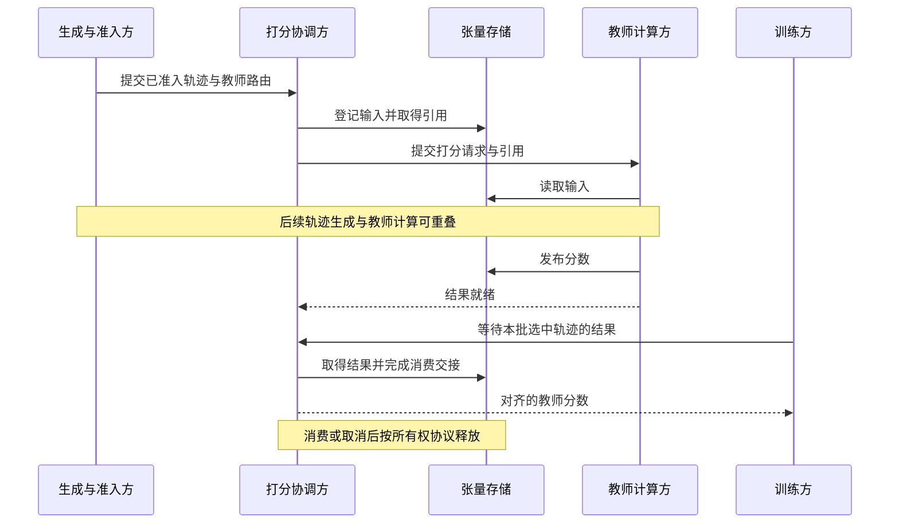

# 异步教师打分的汇合与资源回收

> 日期：2026-11-16
>
> 来源：[当日 Inbox 16:13 条](../../../inbox/2026-11-16.md#1613异步教师打分的汇合与资源回收)
>
> 状态：已整理；以下是通用设计推导，不是特定服务的实现保证。

## 整理记录

- 2026-11-16 18:27：Antigravity 自动整理（当天主整理）

## 0. 今天最终要解决的问题

用户先问多教师打分的接口与执行链路，再问已有实现哪些部分可复用。本篇仅回答可公开复用的问题：教师打分何时启动、何时等待，取消后谁回收数据？

## 1. 先给结论

- 打分可以在单条或一组轨迹准入后启动，与后续生成重叠；训练使用某批轨迹前，必须汇合这批对应结果。
- 异步改变执行时间，不应改变教师路由、token 对齐或训练样本权重。
- 控制消息只传引用能避免把大张量塞入控制接口，但数据仍要搬运，引用仍有生命周期。
- 若教师与训练共享显存，切换前要暂停接收、排空在途计算，再卸载；取消不能只删除等待句柄。

## 2. 前置概念

### 2.1 启动点与依赖点

打分需要已生成的 token，但通常不需要等整个训练批次全部生成完。训练 loss 需要这批轨迹对应的教师分数，因此它才是必须等待的依赖点。

### 2.2 控制消息与张量数据

控制消息表达“给哪份输入、由哪个教师打分”；数据存储负责张量字节。引用不是数据本身，也不自动证明远端已经消费完数据。

## 3. 完整原理

### 3.1 把计算提前，把等待留在使用之前

若生成耗时为 G、打分总耗时为 S，完全串行约为 `G + S`；有资源且可充分重叠时，理想下界接近 `max(G, S)`，实际仍受依赖、长尾、排队与传输影响。这是模型化估算，不能据此宣称某系统实际提速。

### 3.2 合批按计算兼容性，汇合按原始归属

同一教师且输入契约兼容的样本可按 token 预算拼批，算完再按轨迹与行位置还原。路由标识不能在张量整理过程中丢失，重排也不能让分数串到另一条轨迹。

计算副本如何分配是部署选择。独立副本、分布式副本各有约束，不能把某个实现的并行度限制当成 MOPD 的算法要求。打分重新合批也不能改变训练侧的归一化分母。

### 3.3 三个完成点不能混为一谈

| 完成点 | 意义 | 仍需处理 |
|---|---|---|
| 计算完成 | 分数已算出 | 发布、汇合与消费者交接 |
| 请求取消 | 调用方不再需要结果 | 停止排队或处理在途完成竞态 |
| 资源释放 | 没有使用者再依赖输入或输出 | 才能真正回收存储 |

设计时应让成功、异常、取消都能到达释放路径；晚到结果不能重新挂回已取消批次。释放要尊重计算方和消费者的使用期限，不能为了清空计数提前删掉仍在用的张量。

### 3.4 共卡切换要等实际计算结束

“停止收新请求”不代表“GPU 已空闲”。先停止接收，再处理排队与在途请求、确认计算结束，之后卸载教师并进入训练。恢复时重新允许提交。验证要覆盖切换时恰好完成、失败、取消的情况。

## 4. 与已有知识的联系

- [多教师在线蒸馏的实现要点](多教师在线蒸馏的实现要点_20261109.md)已覆盖路由、配额、裁剪与数值防护；本次只补打分提前、按需汇合和资源回收。
- [Ray 对象引用生命周期](../10/Ray进程模型对象引用生命周期与重算队列_20261013.md)解释引用与对象；[附加模型的显存编排](../10/附加模型的显存编排与判分服务设计_20261026.md)解释共享显存的成本。

## 5. 工程中的具体表现

| 现象 | 候选原因 | 如何验证 |
|---|---|---|
| 打分都已完成，训练仍等很久 | 等了不属于本批的结果 | 记录依赖集合与各阶段时间 |
| HTTP 很小，内存仍增长 | 结果引用未释放 | 追踪成功、失败、取消后的存活对象 |
| 共卡切换时显存冲突 | 队列暂停但计算未排空 | 在途计算结束与卸载时间对照 |

## 6. 常见误解

| 容易误解为 | 更准确的理解 |
|---|---|
| 异步等于训练不必等待分数 | 可以早算，使用前仍有依赖 |
| 只传引用就是零传输 | 控制载荷变小，张量数据仍需流动 |
| 取消等待就回收了所有资源 | 计算、结果与引用要分别收尾 |

## 7. 一分钟复习

1. 准入后早启动，训练使用前按选中轨迹汇合。
2. 计算可重排，教师路由、位置与训练权重不能错。
3. 计算完成、取消完成、资源释放是三个不同节点。

## 8. 自测问题

### 问题 1

为什么早提交打分不等于修改 MOPD 算法？

期望回答：只改变执行时序；教师、样本、位置与 loss 权重保持一致，并在训练使用前汇合。若改变了样本选择或归一化，则已超出调度优化。

### 问题 2

训练丢弃了一条轨迹，还需要做什么？

期望回答：取消未开始的任务，协调在途任务与晚到结果，释放输入和输出引用，并保证不会串入后续批次。

## 9. 尚未解决与后续路线

- 尚未验证实际吞吐、取消竞态或显存回收；上述生命周期是设计检查项。
- 摘录的审计结论后半段被截断，未纳入任何缺失的实现结论。

## 10. 实验或参考材料

- Antigravity 会话 4bf2b436，16:13～16:18；仅依据可见内容提炼通用设计，不保留内部接口名称与配置。
